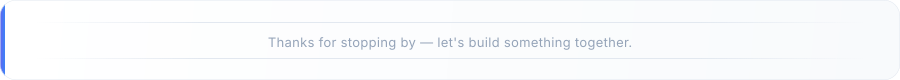

 
 

## About me

I'm a Computer Science student who learns by building real things.  
Currently focused on **[Flatfolks](https://github.com/brintodas/Flatfolks)** — a flat-sharing & roommate finder platform — and levelling up my full-stack skills every day.

- 🎓 &nbsp; Studying **Computer Science & Engineering**
- 🚀 &nbsp; Building **[Flatfolks](https://github.com/brintodas/Flatfolks)** — find your perfect flatmate
- 🌱 &nbsp; Learning: **TypeScript · Next.js · PostgreSQL · Docker**
- 💬 &nbsp; Ask me about **React, Node.js, or web apps in general**
- 📬 &nbsp; Reach me at **[brintodas.cse@gmail.com](mailto:brintodas.cse@gmail.com)**

 

## Tech stack

#### Languages

#### Frontend

#### Backend & Database

#### Tools & DevOps

 

## GitHub stats

<table>
  <tr>
    <td>
      <picture>
        <source media="(prefers-color-scheme: dark)"  srcset="https://raw.githubusercontent.com/brintodas/brintodas/output/github-snake-dark.svg" />
        <source media="(prefers-color-scheme: light)" srcset="https://raw.githubusercontent.com/brintodas/brintodas/output/github-snake.svg" />
        
      </picture>
    </td>
    <td valign="top">
      
    </td>
  </tr>
</table>

 

<table>
  <tr>
    <td>
      
    </td>
    <td>
      
    </td>
  </tr>
</table>

 

## Featured project

> **Flatfolks** — A flat-sharing and roommate finder platform. Find compatible flatmates, list your space, and make moving in easier.

 

## Let's connect

&nbsp;

&nbsp;

 
 

 

